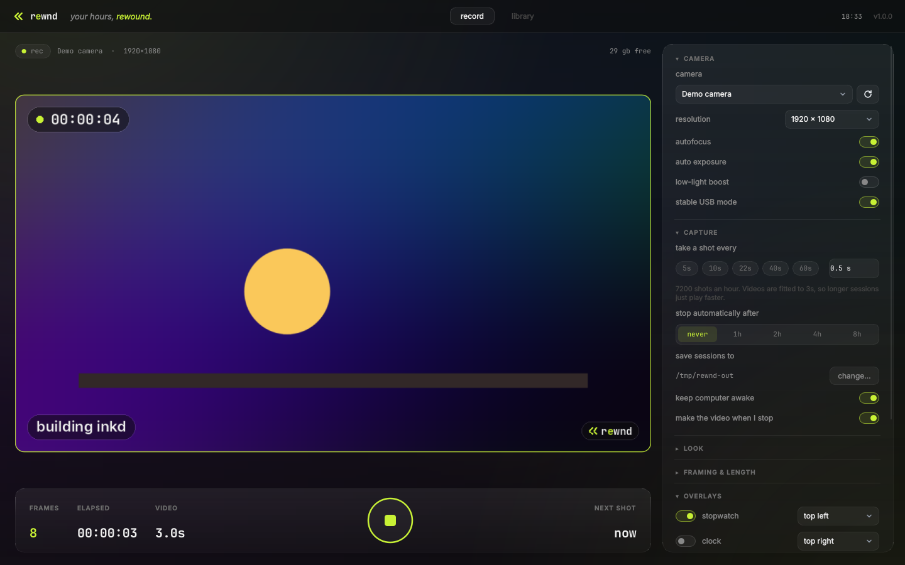
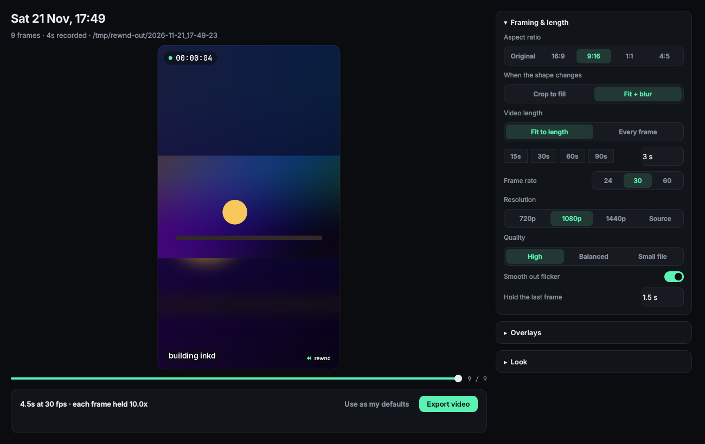
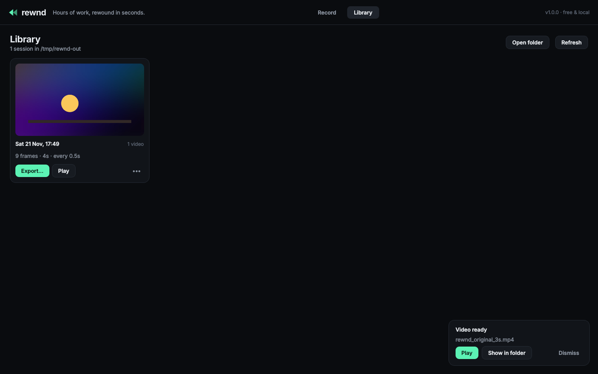

<p align="center"><b>rewnd</b></p>
<p align="center"><i>your hours, rewound.</i><br>
A free webcam timelapse app for Windows and Linux. Everything stays on your computer: no account, no cloud, no watermark you can't turn off.</p>



## Download

**[Get the latest release →](https://github.com/z3zZ/rewnd/releases/latest)**

- **Windows:** download `rewnd-windows.zip`, unzip it anywhere, and run `rewnd.exe`. Windows may show a SmartScreen warning because the app isn't code-signed: click *More info → Run anyway*.
- **Linux:** download `rewnd-linux.tar.gz`, extract it, and run `./rewnd/rewnd`.

No Python, no ffmpeg, no account needed. Everything stays on your computer.

## What it does

Point any webcam at your desk, hit record, and work. rewnd takes a shot every few seconds, and when you stop it hands you a finished, share-ready video: vertical for TikTok/Reels/Shorts if you want, with a stopwatch showing how long it really took.

- **Live preview that matches the export.** What you see while recording (crop, colour, overlays) is exactly what the video looks like.
- **One-click vertical video.** 9:16, 1:1, 4:5 or 16:9, cropped to fill (with a slider to choose what's in frame) or fitted over a blurred copy of the shot.
- **Fit to length.** Recorded for 6 hours? Ask for a 30 second video and rewnd picks the frames for you. No more speeding up and dropping frames by hand. Or use every frame at 24, 30 or 60 fps.
- **Overlays.** A real-time stopwatch, the time of day, your own caption, and a small rewnd tag. Pick the corner, size and background, plus a primary colour (dots and icons) and a secondary colour (text) from a colour wheel.
- **Three themes.** *black* (flat deep black and lime), *light* (its inverse) and *aero* (glossy Frutiger Aero glass), plus any accent colour from the wheel in the top bar.
- **Fix the camera, not just the video.** Mirror (for webcams that flip you), upside down, rotate, brightness, contrast, saturation, warmth. All of it is non-destructive, so you can change your mind and re-export later.
- **Camera control.** Manual focus (turn autofocus off and set it with a slider, so the shot stops pulsing in and out of focus), a low-light boost, and on Windows the camera's own driver settings window.
- **Exposure that handles bright screens.** *Protect* (the default) lowers the exposure until monitors and windows stop blowing out to white. *Manual* gives you a slider. *Scheduled* sets it by time of day, or by sunrise and sunset, easing each change in over 25 minutes so the video doesn't flash. *HDR* takes 2–3 exposures per frame and blends them, like a phone does, so the screens and the room both keep their detail.
- **Doesn't drop out.** The camera stays open for the whole session and reconnects by itself if it disconnects. Stable USB mode (MJPEG) keeps bandwidth low on hubs and long USB extension cables.
- **Smooth motion**, like Skyflow: each video frame blends the shots around it, so movement flows instead of jumping and camera noise averages out. *Light* or *Strong*.
- **Smooth out flicker**, hold the last frame at the end so your result lands, and choose High / Balanced / Small file quality.
- **Library.** Every session in one place, with thumbnails. Re-export in a different shape or length any time, rename, play, or delete.
- **Built for long sessions.** Keeps the computer awake while recording, auto-stops after 1–8 hours if you want, and shows free disk space.

| Export | Library |
|---|---|
|  |  |

## Run from source

You need **Python 3.9+** ([python.org](https://www.python.org/downloads/); on Windows tick *Add Python to PATH*). ffmpeg comes bundled, so there's nothing else to install.

**Windows:** download or clone the repo, then double-click **`run.bat`**, or run `.\run.bat` from PowerShell in the repo folder.

**Linux / macOS:**

```bash
git clone https://github.com/z3zZ/rewnd.git
cd rewnd
./run.sh
```

The first launch sets up a private environment in `.venv` (about a minute). After that it opens instantly.

On Linux, rewnd sets focus, exposure and low-light controls directly through V4L2, so nothing extra is needed. Optional: `sudo apt install v4l-utils` lists each camera's exact resolutions.

### Build a standalone app

To share rewnd with people who don't have Python:

```bash
pip install -r requirements.txt pyinstaller
python build.py
```

Zip up `dist/rewnd/` and send it. On Windows they run `rewnd.exe`.

## Using it

1. **Record tab:** pick your camera and resolution, and set how often to take a shot (22s and 40s are good for long work sessions).
2. Set up the look while watching the live preview: mirror, framing, overlays.
3. Hit the **record button** (or press **Space**). The ring around it counts down to the next shot.
4. Stop when you're done. The video exports straight away and you get a *Play* / *Show in folder* prompt.
5. Want a different version, such as horizontal for YouTube? Open the **Library**, hit *Export…*, scrub through the session, change the settings and export again.

Sessions are saved in `~/Timelapses/<date_time>/`: the raw frames in `frames/`, plus every video you export. Raw frames are kept untouched, so any session can be re-exported with new settings.

**Shortcuts:** `Space` record/stop · `Ctrl+1` Record · `Ctrl+2` Library

## Scheduled exposure

For sessions that run from daylight into the evening, set the camera's exposure to **scheduled**.

- **Profiles** each have a name, a time range and an exposure you type in. A range that ends before it starts (22:00–02:00) runs past midnight. Where ranges overlap, the one higher in the list wins. Outside every range, **night** applies.
- **Sunrise / sunset** runs the profile you pick while the sun is up and night the rest of the time. rewnd asks the computer where it is (Windows location service, or GeoClue on Linux) only in this mode, or you can type a city or coordinates such as `51.5, -0.12`. The city list is built in, so nothing is looked up online.
- **Exposure values are in stops**: the shutter is open for 2^value seconds, so `-6` is 1/64 s, `-7` is half as bright and `-5` twice as bright. Decimals are fine, and the same number means the same thing on Windows and Linux.
- **Easing.** A switch starts at its time and glides to the new value over the ease time (25 minutes by default). While you're not recording, changes apply straight away so the preview shows them. Shots always stay on their interval: rewnd changes the camera just after a shot, not just before one.
- With **HDR** on, the bracket is taken around the schedule's current value.
- The bottom bar shows the active profile and when the next switch is.
- Windows cameras only take whole stops. rewnd sets the nearest one and makes up the rest in the picture (logged per frame, applied in the preview and the export), so easing stays smooth instead of stepping.
- If a camera doesn't let apps set its exposure, rewnd says so and leaves it on auto, in every exposure mode.

## Tips

- **Webcam showing you mirrored?** Look → Mirror.
- **Screens or a window showing as flat white?** Use *Protect* exposure. If the room then looks too dark, turn on *HDR* (needs at least 2.5 s between shots).
- **Video pulsing between sharp and blurry?** That's autofocus hunting. Turn *autofocus* off and drag *focus* until your desk is sharp.
- **Lighting keeps pumping up and down?** Switch exposure to *Manual* once the shot looks right, and leave *Smooth out flicker* on.
- **Focus hunting while you move?** Turn off Autofocus after it has focused on your desk.
- **Camera keeps disconnecting on an extension cable or hub?** Keep *Stable USB mode* on, and try a powered hub or a port directly on the computer. rewnd will reconnect and carry on either way.
- **Recording overnight?** Keep the laptop plugged in. With *Keep computer awake* on, the screen can turn off but recording carries on. Closing the lid will usually still sleep a laptop.

## How it works

rewnd keeps the webcam stream open through OpenCV (DirectShow on Windows, V4L2 on Linux) and saves the newest frame as a JPEG on each tick, along with its timestamp. Exporting runs each chosen frame through the same pipeline as the live preview (orient → colour → frame to aspect → overlays) and streams it into ffmpeg (H.264, `yuv420p`, `+faststart`, so it plays everywhere and uploads cleanly).

Settings live in `%APPDATA%\rewnd\config.json` on Windows and `~/.config/rewnd/config.json` on Linux. Settings from the old version are carried over automatically.

## Development

```bash
pip install -r requirements.txt pytest
python -m pytest
REWND_FAKE_CAMERA=1 python -m rewnd   # run with a demo camera, no webcam needed
REWND_FAKE_CAMERA=1 REWND_FAKE_NO_EXPOSURE=1 python -m rewnd   # ...one that can't set its exposure
```

Design follows the klokd / errnd family: flat deep black, JetBrains Mono, lime `#C8F135` accents.

Fonts: [Inter](https://rsms.me/inter/) and [JetBrains Mono](https://www.jetbrains.com/lp/mono/), both under the SIL Open Font License (see `rewnd/assets/fonts`).

## License

rewnd is released under the [MIT License](LICENSE). Bundled fonts keep their own licences (above).
